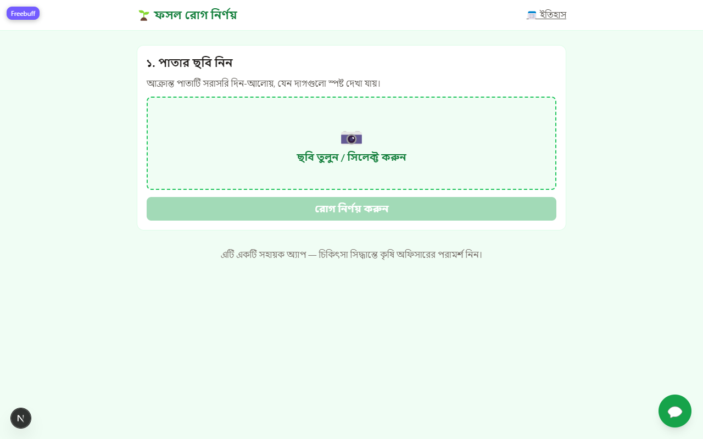
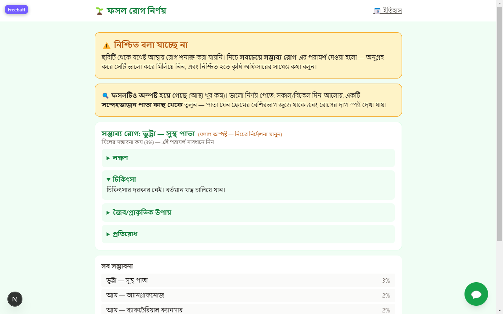

# 🌿 AI Crop Disease Detector for Bangladeshi Farmers

**Mobile-friendly web app that identifies crop diseases from a leaf photo — in Bangla.**

A farmer uploads (or captures) a photo of a plant leaf using a $100 Android phone. The app
detects the crop and the most likely disease, shows a confidence score with top-3
alternatives, and gives **treatment advice written in simple Bangla**. When the model is
not confident, it says so honestly, still shows its best guess's advice labeled
low-confidence, and recommends consulting the local agriculture officer — because a wrong
pesticide recommendation can destroy a farmer's season.

🌐 **Live app:** https://ai-crop-disease-detector-for-bangla-three.vercel.app

| Home (upload) | Result (honest "low confidence" state, with best-guess advice) |
| --- | --- |
|  |  |

> ## 🇧🇩 কৃষকদের জন্য, বাংলায়
> এই অ্যাপটি পাতার ছবি দেখে **১১ ফসলের ৬১টি অবস্থা** (রোগ, পোকার আক্রমণ, সুস্থ) শনাক্ত
> করে এবং সহজ বাংলায় চিকিৎসা পরামর্শ দেয়। নিশ্চিত না হলে অ্যাপ সবচেয়ে সম্ভাব্য রোগের
> পরামর্শ "কম আস্থায়" লেবেলসহ দেখায় এবং কৃষি কর্মকর্তার পরামর্শ নেওয়ার জন্যও বলে।
> অ্যাপ যেসব ফসল চেনে সেগুলির তালিকা নিচে "What it CAN recognize" অংশে আছে।

[](https://ai-crop-disease-detector-for-bangla-three.vercel.app)


---

## ✨ Features

| Feature | Description |
| --- | --- |
| 📷 **Scan a leaf** | Capture with the phone camera (`capture="environment"`) or pick a file |
| 🚫 **Non-leaf guard** | Tuber/product-style photos and flat/blank images are refused with clear Bangla guidance instead of a fake low-% diagnosis |
| 🧠 **AI diagnosis** | Crop + condition prediction across **61 trained classes on 11 crops** |
| 📊 **Confidence + top-3** | Confidence % and three alternatives, so the farmer sees the whole picture |
| 🟡 **Honest uncertainty** | Below the calibrated confidence threshold the app refuses to guess: it shows the best guess's advice labeled low-confidence + "consult an agriculture officer" |
| 🖼 **Unclear-crop warning** | If the top-3 spans multiple crops, the UI warns that the crop itself is unclear and gives photo-quality tips |
| 💊 **Bangla treatment advice** | Curated guideline per class (symptoms, treatment, organic option, prevention, "when to call an expert") — 11 expert-reviewed, 50 drafted **and flagged as drafts** until verified |
| 🗂 **Scan history** | Past scans saved; `/history` page (backend SQLite) |
| 💬 **Chatbot** | Q&A widget grounded in the same guideline data |
| 📱 **Installable (PWA)** | "Add to Home Screen" on Android/Chrome → runs like a native app |
| 🌐 **Bangla-first UI** | Full Bangla interface, Noto Sans Bengali, designed for farmers |

---

## ✅ What it CAN recognize (11 crops · 61 classes)

These are the exact classes the shipped model was trained on. For each, the app gives
a diagnosis confidence plus Bangla advice (symptoms / treatment / organic option /
prevention / when to call an expert).

| Crop (English / বাংলা) | Classes |
| --- | --- |
| **Rice / ধান** | healthy · blast · brown spot · bacterial leaf blight · tungro |
| **Potato / আলু** | healthy · early blight · late blight |
| **Tomato / টম্যাটো** | healthy · bacterial spot · early blight · late blight · leaf mold |
| **Chilli / মরিচ** | healthy · bacterial spot · cercospora leaf spot · curl virus · nutrient deficiency · white spot |
| **Maize (corn) / ভুট্টা** | healthy · common rust · gray leaf spot · northern leaf blight · lethal necrosis · streak virus |
| **Cauliflower / ফুলকপি** | healthy · black rot · insect holes |
| **Cucumber / শসা** | healthy · anthracnose · bacterial wilt · belly rot · downy mildew · gummy stem blight · pythium fruit rot |
| **Grape / আঙুর** | healthy · bacterial leaf spot · black rot · downy mildew · esca · leaf blight · powdery mildew |
| **Mango / আম** | healthy · anthracnose · bacterial canker · cutting weevil · die back · gall midge · powdery mildew · sooty mould |
| **Okra (lady's finger) / ঢেঁড়স** | healthy · alternaria leaf spot · cercospora leaf spot · downy mildew · leaf curl virus · phyllosticta leaf spot |
| **Papaya / পেঁপে** | healthy · anthracnose · bacterial spot · curl · ring spot |

The machine-readable list lives in [backend/app/data/labels.json](backend/app/data/labels.json)
(class name, English name, Bangla name, crop).

## ❌ What it CANNOT recognize

The model only knows the 61 classes above. It has **no training for any other crop**,
including (common in Bangladesh — deliberately listed so nobody wastes a scan):

**Vegetables:** brinjal/eggplant (বেগুন), onion (পেঁয়াজ), garlic (রসুন), bean (শিম),
lentil (মসুর), mustard (সরিষা), bottle gourd (লাউ), pumpkin (মিষ্টি কুমড়া), sweet
potato (মিষ্টি আলু), spinach & leafy vegetables (শাক-পালং), radish (মুলো), carrot,
watermelon (তরমুজ), ginger (আদা), turmeric (হলুদ)

**Grains / cash crops:** wheat (গম), sugarcane (আখ), jute (পাট), pulses, groundnut
(চিনাবাদাম)

**Fruits:** banana (কলা), guava (পেয়ারা), jackfruit (কাঁঠাল), litchi (লিচু), date palm
(খেজুর), lemon (লেবু)

**What actually happens if you upload one of these:** the app will not silently invent a
disease. The top-1 confidence usually falls far below the calibrated threshold, so you get
the *"নিশ্চিত বলা যাচ্ছে না"* (cannot confirm) screen with the officer recommendation. But
**do not treat a result as correct just because a crop name matches** — e.g. it may label
a brinjal leaf "tomato early blight" because tomato is the nearest-looking trained class.
Rule of thumb: if your crop is not in the ✅ table, treat any suggestion as noise.

Adding a new crop is a documented data → train → export pipeline — see
[ml/src/download_data.md](ml/src/download_data.md) (it already contains dataset
candidates for eggplant and others).

---## ⚠️ Limitations — read before trusting a diagnosis

Written in plain language for everyone (farmers, reviewers, developers):

0. **Photos of anything other than a plant leaf are rejected, not diagnosed.**
   The app runs a pre-inference sanity gate: a photo that is not a leaf — e.g. a
   sprouted potato/tuber/fruit on a plain product-style background, or an empty/flat
   color image — gets a clear Bangla message ("ছবিতে গাছের পাতা ধরা পড়েনি…") instead of
   a misleading low-percentage "diagnosis". The gate is a color/texture heuristic
   calibrated against the real test split; it cannot catch every non-leaf photo
   (people, documents, distant blurry leaves pass through and rely on the
   low-confidence path below).
1. **It helps, it does not replace an expert.** This app never replaces an agriculture
   officer or a plant-pathology expert; every result screen repeats that message.
2. **Test accuracy is ~43% per class (61-way task), and that is on clean lab photos.**
   Real phone/field photos are harder — low light, motion blur, cheap cameras, images
   saved from Google (compressed, random framing). The marginal classes listed below
   take the biggest hit. The app's calibrated confidence threshold (see below) is the
   safety valve.
3. **Confident ≠ always right.** Above 0.97 confidence the measured "confident path"
   precision is ~94% — good, but 1 in ~14 confident answers can still be wrong. When in
   doubt, take a second photo from another angle and re-scan.
4. **One leaf at a time.** The photo should be a single suspected leaf filling most of the
   frame, in daylight. Whole-plant shots, shadows, soil, or blurring hurt accuracy badly.
5. **Only leaf-visible problems.** Root rots, stem borers inside the stem, soil nutrient
   issues that don't mark the leaf, and viral diseases in their latent phase can't be seen
   in a leaf photo at all.
6. **Uneven per-class quality.** Some classes are strong (e.g. maize common rust, streak
   virus, mango cutting weevil — F1 0.68–0.76), others are weak (cucumber classes and
   okra classes scored near 0 on the test split — see the full table in
   [ml/reports/metrics.md](ml/reports/metrics.md)). A "2%" guess listed under the
   uncertain screen should be treated as a hint, not a diagnosis.
7. **Advice text is mostly draft.** 11 of 61 guideline entries were reviewed by an
   agriculture officer; the other 50 were carefully written but are still flagged as
   drafts inside the data file until a Bangla agriculture officer verifies them.
8. **Some advice may overlap real pesticide regulation** — doses/products in drafts follow
   standard practice text but must be locally verified before commercial use.
9. **Needs internet.** Photos are sent to the server; there is no offline on-device model.
10. **Upload limits:** JPG/PNG, max 5 MB, minimum 64×64 px — anything else is rejected
    with a clear message.
11. **Serverless deployment quirks:** after ~15 min idle the backend cold-starts (first
    scan is slower), and scan history uses a ephemeral SQLite file that resets on
    redeploy.
12. **Some source datasets allow non-commercial use only** (see the dataset table) — this
    repository is fine as research/portfolio/education, but a commercial product needs
    permission or replaced data sources.
13. **Languages:** the interface is Bangla-first; the model itself is language-agnostic.

---

## 📊 Model & methodology

### Pipeline (reproducible end-to-end)

```
download public datasets (11 sources, links below)
→ ml/src/extract_new_datasets.py   extract & rename to canonical class folders
→ ml/src/prepare_data.py           merge + stratified 70/15/15 split (seed 42)
→ ml/notebooks/train_kaggle.ipynb  train on free GPU (Colab/Kaggle T4)
→ ml/src/evaluate.py               per-class metrics on the held-out test split
→ ml/src/calibrate_threshold.py    pick the confidence threshold on validation
→ ml/src/export_onnx.py            Keras → ONNX with numerical parity check
→ backend/app/data/model.onnx + labels.json   shipped to the backend
```

### Model

| | |
| --- | --- |
| Architecture | **MobileNetV2** (ImageNet weights) + new classification head |
| Training | Transfer learning, two stages: head-only (lr 1e-3) → fine-tune top layers (lr 1e-5) |
| Schedule | 5 head epochs + 20 fine-tune epochs with early stopping (best checkpoint kept) |
| Class imbalance | Class-weighted loss |
| Input | 224×224 RGB, normalized to [-1, +1] (identical preprocessing in training and serving) |
| Export | Keras → **ONNX** (8.8 MB); onnxruntime output vs Keras output must match before shipping |
| Serving | ONNX Runtime, CPU-only, model kept warm at backend startup |
| Final task | 61 classes (from 11 in v1) on **97,480 images** |

### Measured performance (never-seen test split — 14,641 images, real run, nothing invented)

| Metric | Value |
| --- | --- |
| Top-1 accuracy (61 classes) | **42.80%** |
| Macro F1 | 0.299 |
| Confidence threshold (calibrated on validation) | 0.97 → "confident path" precision ≈ **94%** |
| Behavior below the threshold | `is_uncertain: true` → honest fallback screen, no fake diagnosis |

Strong classes: maize_common_rust (F1 0.76), maize_streak_virus (0.67), chilli_curl_virus
(0.68), mango_cutting_weevil (0.76). Weak classes: all cucumber classes and most okra
classes (F1 ≈ 0) — the data for them was small and is the top target for the next
training round. **Full per-class table:** [ml/reports/metrics.md](ml/reports/metrics.md) ·
confusion matrix: [ml/reports/confusion_matrix.png](ml/reports/confusion_matrix.png) ·
threshold sweep: [ml/reports/threshold.json](ml/reports/threshold.json).

> Why so much harder than v1 (61% on 11 classes)? Going from 11 to 61 classes with many
> small datasets means weaker per-class separation; fine-grained diseases (e.g. two
> cucumber spot diseases) confuse the model, and macro-F1 punishes the near-zero small
> classes. The uncertainty threshold keeps those errors from reaching the farmer as a
> confident claim.

### Data sources (all public — links included)

| # | Dataset | Used for | Source / link | License note |
| --- | --- | --- | --- | --- |
| 1 | **PlantVillage** (Kaggle mirror) | potato + tomato + maize + grape lab images | [kaggle.com/datasets/abdallahalidev/plantvillage-dataset](https://www.kaggle.com/datasets/abdallahalidev/plantvillage-dataset) · original: [plantvillage.psu.edu](https://plantvillage.psu.edu/) | CC BY-NC-SA (verify mirror) |
| 2 | **Rice Leaf Diseases** | rice lab images incl. tungro | [kaggle.com/datasets/shayanriyaz/riceleafs](https://www.kaggle.com/datasets/shayanriyaz/riceleafs) | CC0 1.0 |
| 3 | **RiceLeafBD** (real-field, Bangladesh) | rice field images | [data.mendeley.com/datasets/kx9rx8p2mz](https://data.mendeley.com/datasets/kx9rx8p2mz) | per Mendeley record |
| 4 | **Chili Plant Leaf Disease — Bangladesh** | chilli | [data.mendeley.com/datasets/w9mr3vf56s](https://data.mendeley.com/datasets/w9mr3vf56s) | CC BY-NC (no commercial use) |
| 5 | **Tanzania maize** (lethal necrosis + streak virus) | maize field images | [zenodo.org/records/15685236](https://zenodo.org/records/15685236) | per Zenodo record |
| 6 | **NGLD — Niphad Grape Leaf Disease** | grape field images | [data.mendeley.com/datasets/8nnd2ypcv3](https://data.mendeley.com/datasets/8nnd2ypcv3) | per Mendeley record |
| 7 | **BD Cauliflower Leaf Disease** | cauliflower | [data.mendeley.com/datasets/x995snz7p3](https://data.mendeley.com/datasets/x995snz7p3) | CC BY-NC |
| 8 | **Cucumber Disease Recognition** | cucumber | [data.mendeley.com/datasets/y6d3z6f8z9](https://data.mendeley.com/datasets/y6d3z6f8z9) | per Mendeley record |
| 9 | **BDPapayaLeaf** | papaya | [data.mendeley.com/datasets/p997fvf526](https://data.mendeley.com/datasets/p997fvf526) | CC BY |
| 10 | **MangoLeafBD** | mango | [data.mendeley.com/datasets/hxsnvwty3r](https://data.mendeley.com/datasets/hxsnvwty3r) | per Mendeley record |
| 11 | **Okra DiseaseNet** | okra | [data.mendeley.com/datasets/nh7zk4hv8z](https://data.mendeley.com/datasets/nh7zk4hv8z) | per Mendeley record |

Full per-dataset license notes: [ml/DATASETS.md](ml/DATASETS.md) and
[ml/src/download_data.md](ml/src/download_data.md). Raw images are never committed to
git (`.gitignore` ignores `data/` and `ml/data/`); only scripts, reports and the trained
model are in the repo. Training was run on **free Colab/Kaggle T4 GPUs**.

### Skills / tooling used to build this project

- **ML:** transfer learning (TensorFlow/Keras → MobileNetV2), stratified dataset
  splitting, class-weighted loss, per-class evaluation, confidence-threshold calibration,
  ONNX export with numerical parity verification
- **Backend:** Python, FastAPI, pydantic-settings, SQLAlchemy + SQLite, Pillow image
  validation, ONNX Runtime, pytest (23 tests, all run against the real model — no mocks
  for inference)
- **Frontend:** Next.js (App Router, TypeScript), Tailwind CSS, PWA manifest, fetch-based
  API client with Bangla error messages
- **Data curation:** multilingual (Bangla) guideline authoring with honest draft provenance
  flags; dataset-license verification before use
- **DevOps:** GitHub Actions CI (backend pytest on every push), Vercel deployment
  (Next.js + Python serverless in one project)

---

## 🛠 Tech Stack

| Layer | Technology |
| --- | --- |
| Frontend | Next.js (App Router, TypeScript) + Tailwind CSS 4, Noto Sans Bengali, PWA manifest |
| Backend | FastAPI (Python), SQLite via SQLAlchemy, ONNX Runtime inference |
| Deployment | **Single Vercel project** — Next.js service + Python serverless function (`api/index.py` mounts the backend under `/api/*`), shared origin, no CORS needed |
| ML | TensorFlow/Keras (MobileNetV2) → ONNX → onnxruntime |
| Advice pipeline | Curated Bangla guideline JSON (static, expert-curated) + optional grounded LLM rewrite layer (off by default; only ever rephrases the curated JSON) |
| CI | GitHub Actions ([backend-ci.yml](.github/workflows/backend-ci.yml) — pytest on every push) |

---

## 🧭 How it works (request flow)

```
photo upload → validate (size/type/size-in-px) → plant-leaf sanity gate
→ preprocess (224×224, [-1,+1], EXIF-safe)
→ ONNX inference (softmax) → calibrated threshold (0.97)
   ├─ confident → guideline lookup → diagnosis + Bangla advice
   └─ low confidence → best-guess advice labeled low-confidence
                       + "consult the agriculture officer" → is_uncertain=true
→ save scan (SQLite) → JSON response
```

Full details: [docs/architecture.md](docs/architecture.md) · API contract:
`backend/app/schemas.py`.

---

## 📱 How to use (for farmers / end users)

1. **Open the app** on any phone browser — or install it once via *Add to Home screen*
   (Android Chrome: menu ⋮ → *Add to Home screen*; iPhone Safari: Share → *Add to Home
   Screen*; desktop Chrome/Edge: install icon in the address bar).
2. **Photograph one suspicious leaf** in daylight, close up, so the leaf fills the frame
   and any spots/holes are clearly visible.
3. **Press "রোগ নির্ণয় করুন" (diagnose).** You get:
   - the most likely crop + disease with a confidence %, and 2 alternatives,
   - Bangla advice panels (symptoms, treatment, organic option, prevention),
   - an expert-consultation note for when the situation exceeds the app.
4. **If the app says "নিশ্চিত বলা যাচ্ছে না" (cannot confirm):** the photo probably didn't
   match a trained condition well. Retry with a better photo — and always confirm with
   your agriculture officer before spraying.
5. **📅 ইতিহাস (History)** keeps your past scans so you can compare over days.
6. **💬 Chatbot** answers follow-up questions from the same advice data.

To build a real **APK**, wrap the PWA with [PWABuilder](https://www.pwabuilder.com)
(paste the live URL → Android package → signed APK/AAB). No code changes needed.

---

## 💻 Requirements & how to run this project locally

**Requirements**

| Tool | Version |
| --- | --- |
| Python | 3.11+ (3.12 recommended) |
| Node.js | 20+ (Next.js dev server) |
| RAM | ~2 GB free (ONNX inference is CPU-only and light) |
| Internet | only for the first `pip` / `npm` install and to use the LLM option |

No GPU is needed to *run* the app — the 8.8 MB ONNX model runs on CPU. Training needs a
GPU; the pipeline was built for free Colab/Kaggle T4.

**Setup**

```bash
# 1) Backend — http://localhost:8000  (GET /health shows model_loaded)
cd backend
pip install -r requirements.txt
uvicorn app.main:app --reload

# 2) Frontend — http://localhost:3000
cd frontend
npm install
npm run dev
# .env.local: NEXT_PUBLIC_BACKEND_URL=http://localhost:8000

# 3) Tests (23 tests, exercised against the real shipped model)
cd backend
python -m pytest tests -v
```

Configuration lives in [backend/app/config.py](backend/app/config.py) and
[.env.example](.env.example) (copy it to `backend/.env` to override): `DATABASE_URL`,
`CONFIDENCE_THRESHOLD` (default: the calibrated 0.97), `ALLOWED_ORIGINS`,
`MAX_UPLOAD_MB`-style upload limits, and an optional `LLM_API_KEY` for the grounded
advice-rewrite layer (leave empty to serve the static guideline JSON — recommended).

Retraining with new data: [ml/src/download_data.md](ml/src/download_data.md)
(section "Adding MORE data later") → Colab notebook → evaluate → calibrate → export.

---

## 📁 Project Structure

```
.
├── frontend/            # Next.js app (Bangla-first UI, PWA)
├── backend/             # FastAPI app (routers, services, data)
│   └── app/data/        # model.onnx (8.8 MB), labels.json, guidelines_bn.json
├── api/                 # Vercel serverless entrypoint (mounts backend under /api/*)
├── ml/
│   ├── notebooks/       # Colab/Kaggle training notebook (free GPU)
│   ├── src/             # download/prepare/extract/train/evaluate/calibrate/export
│   ├── reports/         # REAL metrics: metrics.md, confusion matrix, threshold, history
│   └── DATASETS.md      # dataset sources, licenses, usage
├── docs/                # architecture, deploy guide, screenshots
└── .github/workflows/   # CI (backend pytest)
```

---

## 🚀 Deployment

Deployed on **one free Vercel project** (frontend + backend + model together):

1. Import the repo at Vercel → configuration lives in [vercel.json](vercel.json)
   (Vercel *Services* mode: `web` service = `frontend/`, `api` service = Python function).
2. Environment variables: `NEXT_PUBLIC_BACKEND_URL=/api`, `DATABASE_URL=sqlite:////tmp/scans.db`,
   `CONFIDENCE_THRESHOLD` (see [.env.example](.env.example)), `MAX_UPLOAD_MB=4`.
3. Step-by-step (including the Render/HF Spaces alternative backend):
   **[docs/deploy.md](docs/deploy.md)**.

**Free-tier honesty:** serverless cold starts after ~15 min idle (first scan is slower);
scan history uses `/tmp` SQLite and resets on redeploys; uploads capped at 4 MB in that
deployment.

---

## 🔁 Retraining / contributing a new crop

1. Find a public leaf-disease dataset for the crop (Mendeley/Kaggle/Zenodo — checklist
   with candidates per crop: [ml/src/download_data.md](ml/src/download_data.md)).
2. Check the license **before** using it.
3. Extract into `ml/data/raw/<source>/<canonical_class>/` and run
   `python ml/src/prepare_data.py --merge-sources` (read its output — any `NO IMAGES`
   line means an alias needs fixing).
4. Run the notebook [ml/notebooks/train_kaggle.ipynb](ml/notebooks/train_kaggle.ipynb)
   (data → train → evaluate → calibrate → export ONNX).
5. Copy the new `model.onnx` + `labels.json` into `backend/app/data/`, add guideline
   text per class to `backend/app/data/guidelines_bn.json`, run
   `cd backend && python -m pytest tests -v`.

---

## 🚧 Roadmap

- [x] **Phase 1** — Repository setup
- [x] **Phase 2** — Data + ML (61-class v2 model trained on free GPUs; ONNX export with parity check)
- [x] **Phase 3** — Backend (FastAPI, inference, calibrated threshold, Bangla guidelines, 23 tests)
- [x] **Phase 4** — Frontend (Next.js, Bangla-first UI, upload/result/uncertain, history, chatbot)
- [x] **Phase 5** — Deployment (live on Vercel; PWA installable)
- [ ] **Next: accuracy v3** — collect 50–100 real field photos per class, retrain with
      `--merge-sources`, verify the 50 drafted guideline entries with an agriculture officer
- [ ] **Eggplant (বেগুন)** — first unsupported crop to add (dataset candidates noted in
      [ml/src/download_data.md](ml/src/download_data.md))
- [ ] **Reports/"data engine"** — store anonymized upload thumbnails (opt-in) to build a
      real Bangladeshi field dataset over time

---

## 📜 License

Code: MIT — see [LICENSE](LICENSE). Datasets keep their own licenses (table above);
several are **non-commercial only**.
