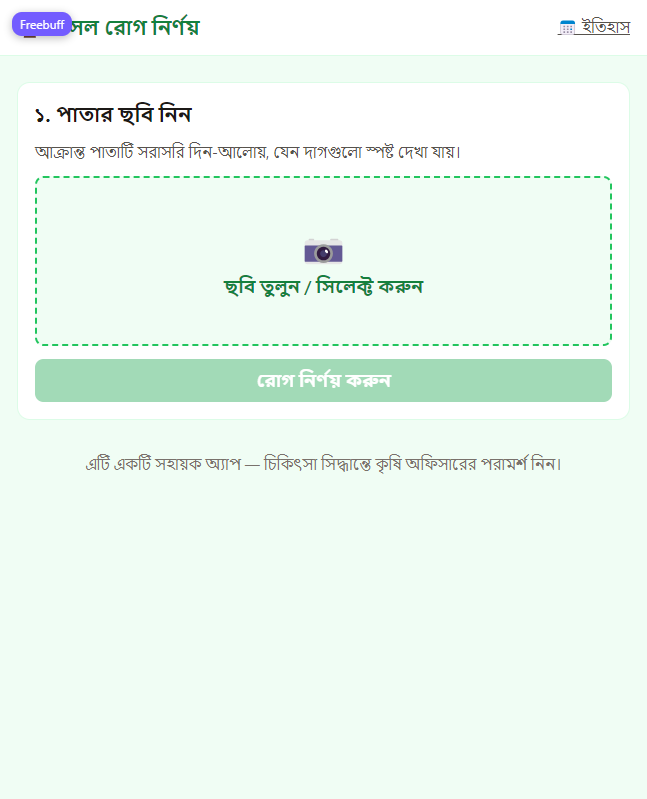
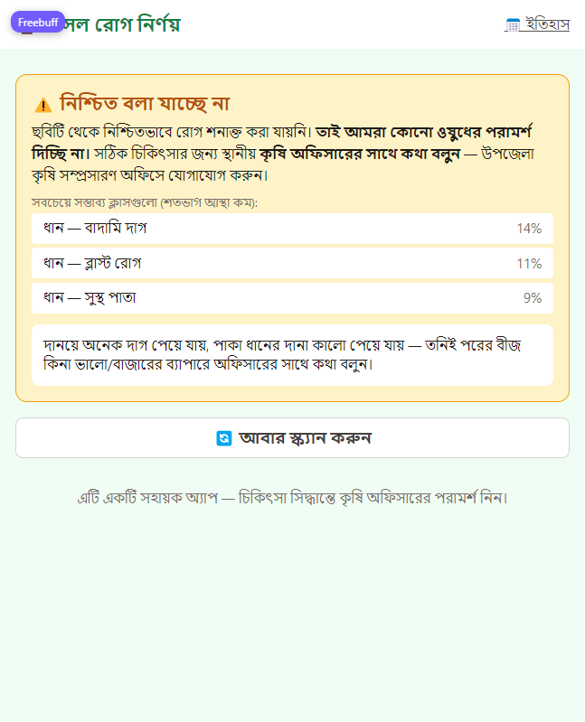

# 🌿 AI Crop Disease Detector for Bangladeshi Farmers

**Mobile-friendly web app that identifies crop diseases from a leaf photo — in Bangla.**

A farmer uploads (or captures) a photo of a plant leaf using a $100 Android phone. The app
detects the crop and the most likely disease, shows a confidence score with top-3
alternatives, and gives **treatment advice written in simple Bangla**. When the model is
not confident, it says so honestly, still shows its best guess's advice labeled
low-confidence, and recommends consulting the local agriculture officer — because a wrong
pesticide recommendation can destroy a farmer's season.

🌐 **Live app:** https://ai-crop-disease-detector-for-bangla-three.vercel.app

| Home (upload) | Uncertain result (honest fallback with advice) |
| --- | --- |
|  |  |

> ## 🇧🇩 কৃষকদের জন্য, বাংলায়
> এই অ্যাপটি পাতার ছবি দেখে ধান, আলু ও টম্যাটোর রোগ শনাক্ত করে এবং সহজ বাংলায় চিকিৎসা
> পরামর্শ দেয়। নিশ্চিত না হলে অ্যাপ সবচেয়ে সম্ভাব্য রোগের পরামর্শ "কম আস্থায়" লেবেলসহ দেখায়
> এবং কৃষি কর্মকর্তার পরামর্শ নেওয়ার জন্যও বলে।

[](https://ai-crop-disease-detector-for-bangla-three.vercel.app)


---

## ✨ Features

| Feature | Description |
| --- | --- |
| 📷 **Scan a leaf** | Capture with the phone camera (`capture="environment"`) or pick a file |
| 🧠 **AI diagnosis** | Crop + disease prediction across 11 classes for rice, potato, tomato |
| 📊 **Confidence + top-3** | Confidence % and three alternatives, so the farmer sees the whole picture |
| 🟡 **Honest uncertainty** | Below the calibrated threshold: best guess's advice shown labeled low-confidence + officer recommendation |
| 💊 **Bangla treatment advice** | Curated guideline per disease: symptoms, treatment, organic option, prevention, "when to call an expert" |
| 🗂 **Scan history** | Past scans saved; `/history` page (backend SQLite) |
| 📱 **Installable (PWA)** | "Add to Home Screen" on Android/Chrome → runs like a native app |
| 🌐 **Bangla-first UI** | Full Bangla interface, Noto Sans Bengali, designed for farmers |

**Supported classes (11):**
rice (blast, brown spot, healthy) · potato (early blight, late blight, healthy) ·
tomato (bacterial spot, early blight, late blight, leaf mold, healthy)

---

## 📊 Model & Data (real, measured — nothing fabricated)

### Model

| | |
| --- | --- |
| Architecture | **MobileNetV2** (ImageNet weights) + new classification head |
| Training | Transfer learning, two stages: head-only (lr 1e-3) then fine-tune top layers (lr 1e-5) |
| Epochs | 5 head + 20 fine-tune with early stopping (best checkpoint kept) |
| Class imbalance | Class-weighted loss |
| Export | Keras → **ONNX** with a numerical parity check (Keras vs onnxruntime outputs must match) |
| Size | 8.97 MB — deployed to Vercel serverless |
| Serving | ONNX Runtime (CPU-only), same preprocessing as training: resize 224×224, normalize to [-1, +1] |

### Measured performance (test split — 5,220 images, never-seen during training)

| Metric | Value |
| --- | --- |
| Top-1 accuracy | **61.34%** |
| Macro F1 | 0.526 |
| Calibrated threshold | 0.97 (precision 93.6% @ 9.9% coverage on validation) |

Strong classes: tomato_bacterial_spot (F1 0.79), tomato_healthy (0.74), potato_early_blight (0.72).
Weak: tomato_early_blight recall (0.20), potato_late_blight (0.46), rice classes (lab-vs-field gap).
**Full per-class table:** [ml/reports/metrics.md](ml/reports/metrics.md) · confusion matrix:
[ml/reports/confusion_matrix.png](ml/reports/confusion_matrix.png)

> ⚠️ **Known limitation (measured, honest):** the model was trained on clean lab datasets,
> so on real field/phone photos it is often right at the top but with low confidence
> (e.g., a potato early-blight leaf ranked #1 at 14%). The app handles this honestly
> (low-confidence advice + officer recommendation). The fix is retraining with real
> field photos — the pipeline is ready (`ml/src/download_data.md` → "Adding MORE data").

### Data sources

| Dataset | Used for | Source | License |
| --- | --- | --- | --- |
| **PlantVillage** (extended) | potato + tomato classes (~24k images) | Kaggle: `abdallahalidev/plantvillage-dataset` | CC BY-SA (research use) |
| **Rice leaf disease** | rice blast / brown spot / healthy | Kaggle rice-leaf-diseases style collection | research use |
| **PlantDoc** | reference for class naming / field variety | GitHub: SpoolTeam/PlantDoc (via [download_data.md](ml/src/download_data.md)) | MIT (code) / dataset research |

Merged into a stratified 70/15/15 train/val/test split (seed 42) by
[ml/src/prepare_data.py](ml/src/prepare_data.py); per-class counts:
[ml/reports/class_distribution.png](ml/reports/class_distribution.png).
Note: **rice_bacterial_leaf_blight and rice_tungro had no images in this run** — the
model shipped with 11 classes; adding them is documented in the same file.

Training was run on **Google Colab free T4 GPU**; the notebook
[ml/notebooks/train_kaggle.ipynb](ml/notebooks/train_kaggle.ipynb) reproduces the whole
pipeline (data → train → evaluate → calibrate → export ONNX).

---

## 🛠 Tech Stack

| Layer | Technology |
| --- | --- |
| Frontend | Next.js 16 (App Router, TypeScript) + Tailwind CSS 4, Noto Sans Bengali, PWA manifest |
| Backend | FastAPI (Python), SQLite via SQLAlchemy, ONNX Runtime inference |
| Deployment | **Single Vercel project** — Next.js service + Python serverless function (`api/index.py` mounts the backend under `/api/*`), shared origin, no CORS needed |
| ML | TensorFlow/Keras (MobileNetV2) → ONNX → onnxruntime |
| Advice pipeline | Curated Bangla guideline JSON (static, expert-curated) + optional grounded LLM rewrite layer (off by default; only ever rephrases the curated JSON) |
| CI | GitHub Actions ([backend-ci.yml](.github/workflows/backend-ci.yml) — 10 pytest tests on every push) |

---

## 🧭 How it works (request flow)

```
photo upload → validate & preprocess (224×224, [-1,+1], EXIF-safe)
→ ONNX inference (softmax) → calibrated threshold (0.97)
   ├─ confident → guideline lookup → diagnosis + Bangla advice
   └─ low confidence → best-guess advice labeled low-confidence
                       + "consult the agriculture officer" → is_uncertain=true
→ save scan (SQLite) → JSON response
```

Full details: [docs/architecture.md](docs/architecture.md) · API contract: `backend/app/schemas.py`

---

## 📁 Project Structure

```
.
├── frontend/            # Next.js app (Bangla-first UI, PWA)
├── backend/             # FastAPI app (routers, services, data)
│   └── app/data/        # model.onnx (9 MB), labels.json, guidelines_bn.json
├── api/                 # Vercel serverless entrypoint (mounts backend under /api/*)
├── ml/
│   ├── notebooks/       # Colab/Kaggle training notebook (free GPU)
│   ├── src/             # download/prepare/augment/train/evaluate/calibrate/export
│   └── reports/         # REAL metrics: metrics.md, confusion matrix, threshold, history
├── docs/                # architecture, deploy guide, screenshots
└── .github/workflows/   # CI (backend pytest)
```

---

## 🚀 Deployment

Deployed on **one free Vercel project** (frontend + backend + model together):

1. Import the repo at Vercel → configuration lives in [vercel.json](vercel.json)
   (Vercel *Services* mode: `web` service = `frontend/`, `api` service = Python function).
2. Environment variables: `NEXT_PUBLIC_BACKEND_URL=/api`, `DATABASE_URL=sqlite:////tmp/scans.db`,
   `MAX_UPLOAD_MB=4`, `CONFIDENCE_THRESHOLD=0.97`.
3. Step-by-step (including the Render/HF Spaces alternative backend):
   **[docs/deploy.md](docs/deploy.md)**.

**Free-tier honesty:** serverless cold starts after ~15 min idle (first scan is slower);
scan history uses `/tmp` SQLite and resets on redeploys; uploads capped at 4 MB.

---

## 📱 Install as an app (Android / iOS / Desktop)

The site is a **PWA** — installable from the browser, no store needed:

- **Android (Chrome):** open the site → menu (⋮) → *Add to Home screen / Install app*
- **iPhone (Safari):** Share → *Add to Home Screen*
- **Desktop (Chrome/Edge):** address-bar install icon → *Install*

To build a real **APK**, wrap the PWA with [PWABuilder](https://www.pwabuilder.com)
(paste the live URL → Android package → signed APK/AAB). iOS/TestFlight and a
plain `.exe` are possible the same way (PWABuilder → Windows package). No code changes needed.

---

## 🔁 Reproduce locally

```bash
# Backend (http://localhost:8000, /health shows model_loaded)
cd backend && pip install -r requirements.txt
uvicorn app.main:app --reload

# Frontend (http://localhost:3000)
cd frontend && npm install && npm run dev   # .env.local: NEXT_PUBLIC_BACKEND_URL=http://localhost:8000

# Tests
cd backend && python -m pytest tests -v     # 10 tests, real model
```

Retraining with new data: [ml/src/download_data.md](ml/src/download_data.md)
(section "Adding MORE data later") → Colab notebook → evaluate/calibrate/export.

---

## 🚧 Roadmap

- [x] **Phase 1** — Repository setup
- [x] **Phase 2** — Data + ML (trained on Colab; ONNX export with parity check)
- [x] **Phase 3** — Backend (FastAPI, inference, calibrated threshold, Bangla guidelines, tests)
- [x] **Phase 4** — Frontend (Next.js 16, Bangla-first UI, upload/result/uncertain, history)
- [x] **Phase 5** — Deployment (live on Vercel; PWA installable)
- [ ] **Next: accuracy v2** — collect 50–100 real field photos per class, retrain with
      `--merge-sources`, re-calibrate the threshold (target: lower 0.97 threshold, fewer
      uncertain results), add the two missing rice classes
- [ ] **Reports/"data engine"** — store anonymized upload thumbnails (opt-in) to build a
      real Bangladeshi field dataset over time

---

## ⚠️ Important Limitations

- **Research/educational prototype.** Advice text should be reviewed by a qualified
  agriculture expert before any real-world deployment. Not a replacement for a
  plant-pathology expert or agriculture officer.
- All published metrics come from the real test run (see [ml/reports/](ml/reports)); nothing is estimated or invented.
- Field-photo performance lags lab performance (measured; the UI communicates this honestly).

## 📜 License

MIT — see [LICENSE](LICENSE).
